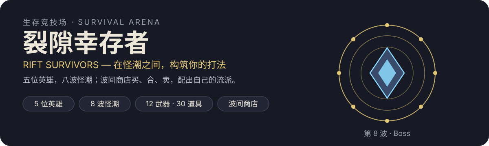
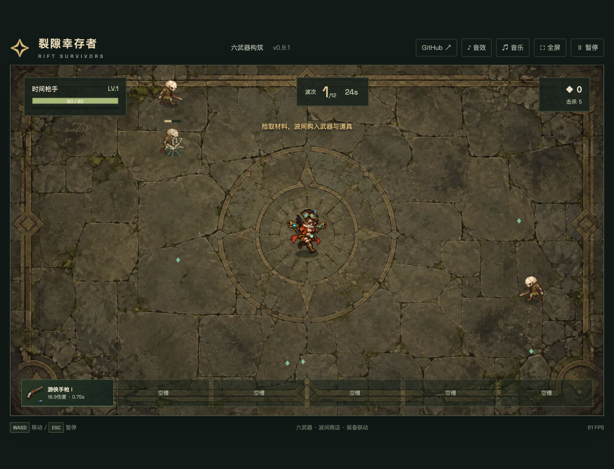

<p align="right"><a href="README.md">中文</a></p>

<p align="center">
  
</p>

<p align="center">
  <a href="https://rift-survivors.xiaosang.cc/">▶ Play Online</a>
  ·
  <a href="https://github.com/holynova/rift-survivors">GitHub Repository</a>
  ·
  <a href="./docs/INDEX.md">Design Docs</a>
</p>

Rift Survivors is a browser survival arena: pick a hero, survive 8 waves of monsters, and beat the Wave 8 Boss. Weapons attack automatically and independently; between waves, buy, fuse, and sell weapons and items in the shop to build your own loadout. Desktop keyboard is the primary input.

## Screenshot

<p align="center">
  
</p>

## How to Play

- **Move**: WASD / arrow keys; weapons attack automatically, and melee hits follow the real swing arc.
- **Skills**: every hero has a Space dash, an E tactical skill, and a Q ultimate (e.g. the Time Gunner's 回溯 Rewind, the Ash Knight's 弹反 Parry).
- **Level up**: kills drop crystals for XP; pick 1 of 3 on level-up.
- **Shop**: visit the shop between waves — 3 items per wave, buy / lock / sell / fuse / refresh (refresh costs 6 gold); healing costs 10 gold (restores 30% max HP).
- **Pause**: Esc to pause; switching tabs auto-pauses.

## Heroes

| Hero | Role | Traits |
|------|------|------|
| 时间枪手 Time Gunner | Ranged | Auto dual pistols; Space triple blink, E 回溯 Rewind to position and HP from 2 seconds ago |
| 灰烬骑士 Ash Knight | Melee | Sword strikes cost stamina; Space roll, E 弹反 Parry, Q 灰烬风暴 Ash Storm |
| 霜环术士 Frost Ring Sorcerer | Control | Ice bolts chain to 3 targets; E 寒霜领域 Frost Domain slows, Q 极寒冰封 Glacial Freeze |
| 机巧召唤师 Clockwork Summoner | Summon | Deploys auto-targeting turrets; Space swaps places with a turret, Q 机械军团 Machine Legion |
| 血刃猎手 Bloodblade Hunter | Lifesteal | Twin-blade fan attacks build blood energy; E 汲血斩 Blood Drain Slash heals, Q 猩红收割 Crimson Harvest |

Each hero also has 3 exclusive upgrades that only enter their own level-up pool.

## Build Mode

A separate six-weapon build mode: 12 weapons (匕首 Dagger, 长矛 Spear, 重锤 Warhammer, 回旋刃 Boomerang Blade, 手枪 Pistol, 连发枪 Repeater, 霰弹 Shotgun, 弩 Crossbow, 冰晶杖 Ice Crystal Staff, 爆破器 Demolisher, 镰刀 Scythe, 哨戒部署器 Sentry Deployer) and 30 items, 6 weapon slots, 12 waves, with a between-wave shop for loadouts. Weapons fall into four families — 近战 Melee / 远程 Ranged / 元素 Elemental / 工程 Engineering — with set bonuses for matching families.

## Run Locally

```bash
npm ci
npm run dev       # Dev server
npm run build     # Type-check + production build
npm test          # Vitest unit tests
npm run test:browser   # Playwright browser tests
```

## Tech

- Phaser 3.90 rendering + React 19 UI, TypeScript + Vite; combat simulation is pure functions (`src/game/simulation.ts`), Phaser only renders.
- Melee hit detection follows the real swing arc (`src/game/melee.ts`); sound effects and music are layered (`src/game/audio.ts`).
- Full design docs: gameplay, numbers, art specs, and test plans all live in `docs/` (see `docs/INDEX.md`).

```
src/game/content.ts        Hero / wave / upgrade content data
src/game/build-content.ts  Build mode: 12 weapons / 30 items / 12 waves
src/game/simulation.ts     Combat simulation (pure functions)
src/game/melee.ts          Melee swing-arc hit detection
src/phaser/scene.ts        Phaser scene and rendering
src/main.tsx               Entry and UI
tests/                     Vitest + Playwright tests
docs/                      Design docs (gameplay / numbers / art / production)
```
