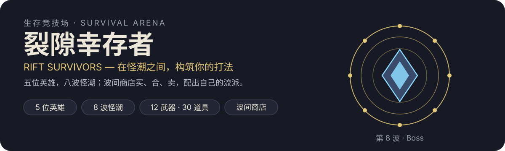
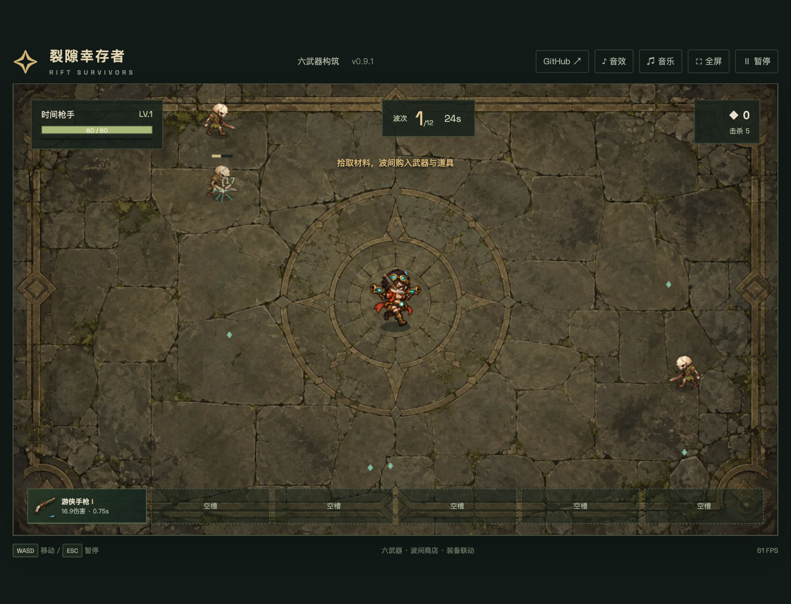

<p align="right"><a href="README.en.md">English</a></p>

<p align="center">
  
</p>

<p align="center">
  <a href="https://rift-survivors.xiaosang.cc/">▶ 在线玩</a>
  ·
  <a href="https://github.com/holynova/rift-survivors">GitHub 仓库</a>
  ·
  <a href="./docs/INDEX.md">设计文档</a>
</p>

裂隙幸存者是一款浏览器生存竞技场：选一位英雄，在 8 波怪潮里活下来，击败第 8 波 Boss 即胜利。武器自动攻击、各自独立；波间进入商店，购买、合成、出售武器与道具，构筑自己的打法。桌面键盘为主要输入方式。

## 截图

<p align="center">
  
</p>

## 玩法

- **移动**：WASD / 方向键；武器自动攻击，近战按真实轨迹接触命中。
- **技能**：每位英雄都有 Space 位移技、E 战术技、Q 大招（如时间枪手的回溯、灰烬骑士的弹反）。
- **升级**：击杀掉落结晶，拾取攒经验，升级时三选一。
- **商店**：波间结算进商店，每波三件商品，可购买、锁定、出售、合成与刷新（刷新 6 金币）；也可花 10 金币治疗（恢复 30% 最大生命）。
- **暂停**：Esc 暂停；切换标签页自动暂停。

## 英雄

| 英雄 | 定位 | 特点 |
|------|------|------|
| 时间枪手 | 远程 | 自动双枪；Space 三层闪现，E 回溯 2 秒前位置与生命 |
| 灰烬骑士 | 近战 | 剑击耗精力；Space 翻滚，E 弹反，Q 灰烬风暴 |
| 霜环术士 | 控场 | 冰箭连锁 3 个目标；E 寒霜领域减速，Q 极寒冰封 |
| 机巧召唤师 | 召唤 | 部署炮台自动索敌；Space 与炮台换位，Q 机械军团 |
| 血刃猎手 | 吸血 | 双刃扇形攻击攒血能；E 汲血斩回血，Q 猩红收割 |

每位英雄另有 3 项专属强化，只进入自己的升级池。

## 构筑模式

另有六武器构筑玩法：12 种武器（匕首、长矛、重锤、回旋刃、手枪、连发枪、霰弹、弩、冰晶杖、爆破器、镰刀、哨戒部署器）与 30 种道具，6 个武器槽位，12 波怪潮，波间商店配装。武器分近战 / 远程 / 元素 / 工程四系，同系成套有加成。

## 本地运行

```bash
npm ci
npm run dev       # 开发服务器
npm run build     # 类型检查 + 生产构建
npm test          # Vitest 单元测试
npm run test:browser   # Playwright 浏览器测试
```

## 技术

- Phaser 3.90 渲染 + React 19 界面，TypeScript + Vite；战斗模拟是纯函数（`src/game/simulation.ts`），Phaser 只负责绘制。
- 近战按真实挥砍轨迹做接触判定（`src/game/melee.ts`）；音效与音乐分层（`src/game/audio.ts`）。
- 设计文档齐全：玩法、数值、美术规范、测试计划都在 `docs/`（见 `docs/INDEX.md`）。

```
src/game/content.ts        英雄 / 波次 / 升级内容数据
src/game/build-content.ts  构筑模式：12 武器 / 30 道具 / 12 波
src/game/simulation.ts     战斗模拟（纯函数）
src/game/melee.ts          近战轨迹接触判定
src/phaser/scene.ts        Phaser 场景与渲染
src/main.tsx               入口与 UI
tests/                     Vitest + Playwright 测试
docs/                      设计文档（玩法 / 数值 / 美术 / 生产）
```
